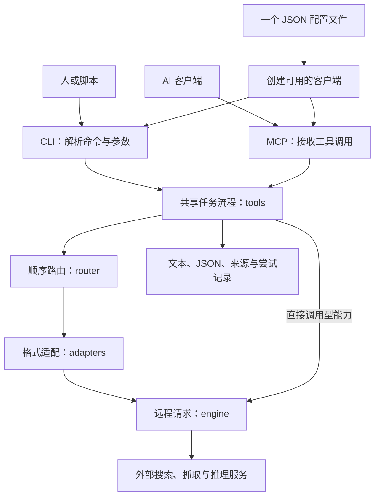
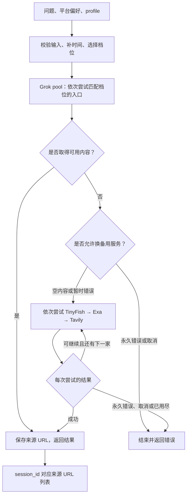
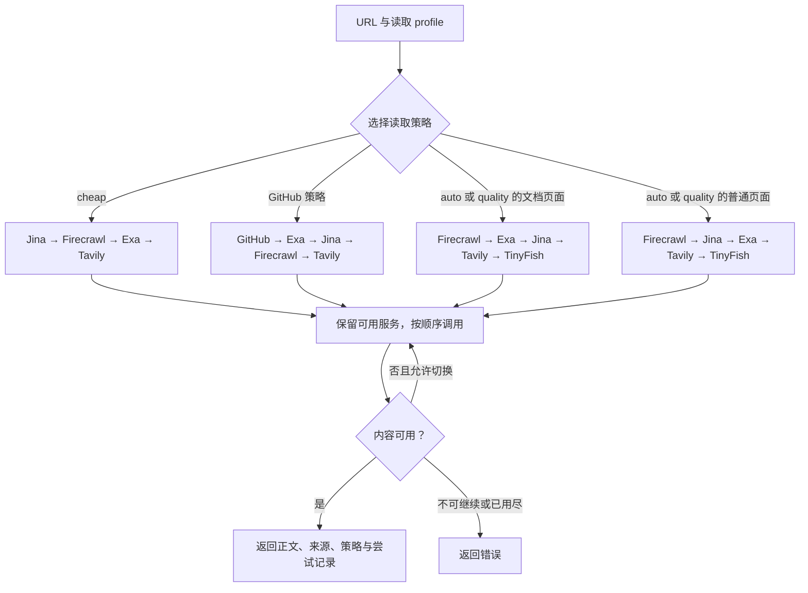
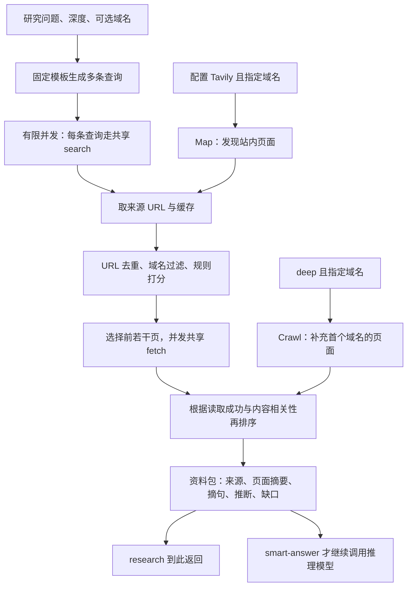
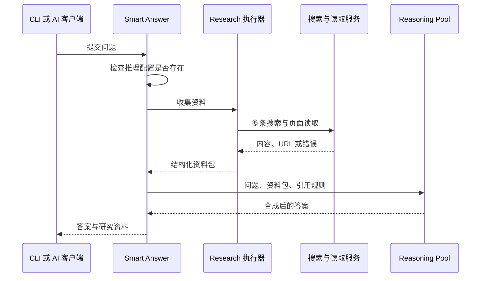

# SourceMux 当前架构：从一次请求理解整个程序

SourceMux 的工作是把「找资料、读网页、写答案」接起来。收到一个问题后，它按规则选择外部服务，收集结果；某个服务失败时，再判断能否换一家继续。搜索网页、抓取正文和生成文字的主要工作由外部服务完成，SourceMux 负责安排顺序和整理结果。

本文面向不熟悉 Go 的读者，说明当前实现，不代表后续接入方案。维护者参考文档保留在 [ARCHITECTURE.md](ARCHITECTURE.md)，参考项目与 JEV 接入讨论见 [smartsearch 调研](SMARTSEARCH_JEV_RESEARCH_ZH.md)，图示概览见 [架构对比展示页](architecture-comparison.html)。

- 调研日期：2026-11-02。
- 源码基线：`dd0c5e7f7ea5daebf4a17216b100dde49c2fcaa7`。
- 核对方式：阅读入口、配置、任务流程、路由、服务商客户端和相关测试；未调用真实付费 API 验证效果。
- 文中的「已实现」指这份源码存在相应路径；运行时能否使用仍取决于配置、服务商权限和网络。

## 1. 先认识六个词

| 词 | 在这个项目中的意思 | 例子 |
| --- | --- | --- |
| CLI | 在终端输入命令，一次执行一个任务 | `sourcemux search "Go release notes"` |
| MCP | AI 客户端调用工具的协议 | AI 调用 `web_search`，程序返回搜索内容 |
| Provider | 程序中对接某个外部服务的部分 | Exa 搜索、Jina 读取网页 |
| Endpoint | 连接远程服务所需的一组设置：地址、模型和访问凭据 | 同一搜索模型可以配置多个可用入口 |
| Pool | 把多个 endpoint 或 key 放在一起，按规则选用 | 一个 Grok 入口失败后再试下一个 |
| Fallback | 当前方法失败后尝试备用方法 | Grok 失败后尝试 TinyFish |

Go 是实现程序所用的语言。理解架构时只需知道：源码分在多个目录，编译后可以得到单个可执行文件；`internal` 里的模块是这个程序的内部组成，并不是分别部署的服务。

## 2. 一个程序，两个入口

从终端输入命令，走的是 CLI；由 AI 客户端发起工具调用，走的是 MCP。进入程序后，两种方式使用同一套搜索和研究流程。使用 MCP 时，AI 客户端启动 SourceMux，再通过标准输入和标准输出传递请求与结果。这是一种程序之间的通信方式，不需要对外开放网页服务。[源码：app.go](../internal/app/app.go) `:55`；[server.go](../internal/server/server.go) `:100`。



图中的「直接调用」表示已经指定了服务。例如 Exa 高级接口直接找 Exa，Tavily Map/Crawl 直接找 Tavily，推理合成也有自己的调用路径，不走普通搜索的备用服务顺序。bootstrap/install 用于安装时配置客户端接入，搜索时无需重复执行。

## 3. 每层只负责什么

| 目录 | 通俗解释 | 主要职责 | 不负责什么 |
| --- | --- | --- | --- |
| `internal/app` | 总入口 | 根据命令决定进入 CLI、安装流程或 MCP | 不决定搜索结果质量 |
| `internal/cli` | 终端窗口 | 读取参数、设置等待时限、准备服务连接，输出文本或 JSON | 不另写一套搜索顺序 |
| `internal/server` | AI 工具窗口 | 保持服务连接对象、列出 AI 可用的工具、暂存来源链接 | 不独立实现研究算法 |
| `internal/config` | 设置读取器 | 读取一个 JSON，校验并统一两种配置格式 | 不自动查找多个配置来源 |
| `internal/tools` | 任务流程 | 搜索、读取网页、研究、答案合成 | 不维护自己的网页索引 |
| `internal/capability` | 统一表单 | 定义请求、结果、能力与失败类型 | 不实际访问网络 |
| `internal/router` | 备用顺序执行器 | 逐家尝试、判断是否继续、记录耗时和原因 | 不理解所有服务商的接口格式 |
| `internal/router/adapters` | 接口翻译器 | 把统一请求和各家格式互相转换 | 不负责最终答案撰写 |
| `internal/engine` | 远程服务客户端 | 向服务发请求、读懂返回结果，失败时重试或换接口 | 不决定整个研究计划 |

CLI 准备各家服务连接的代码在 [providers.go](../internal/cli/providers.go) `:9`；MCP 做同一件事的代码在 [server.go](../internal/server/server.go) `:31`。两边最终调用相同的 `RunWebSearch`、`RunWebFetch` 和研究执行器。

## 4. 搜索：找到可用结果就返回

搜索首先检查问题是否为空，为「今天」「最新」等问题补充当前时间，再处理平台偏好和模型档位。之后按下图尝试已配置的服务。某家成功后立即返回，不会继续请求所有服务商再合并结果。[源码：search.go](../internal/tools/search.go) `:154`、`:362`。



`profile` 是选择 Grok 接口组的设置。`auto` 让程序根据配置、任务类型和关键词，在 `default` 和 `heavy` 两组之间选择；这个判断由代码规则完成，不额外请求模型。research 默认优先选择 heavy。若没有配置 heavy，auto 会改用 default；若命令明确要求 heavy，程序就会报错。[源码：profile_policy.go](../internal/tools/profile_policy.go) `:38`、`:130`。

### 三种「再试一次」分属不同层

| 层级 | 换了什么 | 当前行为 |
| --- | --- | --- |
| HTTP 重试 | 同一个接口再请求 | 公共重试助手默认共 3 次，针对网络失败、429、5xx，等待时间逐渐增加 |
| Pool 切换 | 换 endpoint 或 key | Grok 按配置顺序尝试；TinyFish、Firecrawl 有各自的 key 池 |
| Router fallback | 换服务商 | 搜索按 Grok、TinyFish、Exa、Tavily 顺序，首个成功即停 |

这三层不能简单相乘估算实际请求数，实际还受各客户端策略、成功时机与总超时约束。公共路由默认把空内容和暂时失败视为可切换；取消和永久失败停止。HTTP 429、5xx、超时通常属于暂时失败，其余已识别的 4xx 属于永久失败。[源码：retry.go](../internal/engine/retry.go) `:60`；[classify.go](../internal/router/classify.go) `:21`；[outcome.go](../internal/capability/outcome.go) `:26`。

## 5. 网页读取：先看 URL，再选顺序

网页读取会区分普通页面、文档页面和 GitHub 仓库地址。每个顺序中未配置的服务会被省略，剩余服务依次尝试，首个成功就停止。[源码：fetch_policy.go](../internal/tools/fetch_policy.go) `:38`、`:125`；[fetch.go](../internal/tools/fetch.go) `:71`、`:124`。



图中是程序默认的尝试顺序。使用 v2 配置时，可以自行指定 auto 模式下的 provider 顺序。不过，GitHub URL 会先切换到 github 策略，不使用这项自定义顺序。quality 模式会开启 Firecrawl 的 clean-content 内容清理选项，并允许它等待更久；auto 默认不开启。普通 CLI 读取默认最多等待 60 秒，quality 为 300 秒。research 另有规则，每页最多等待 25 秒。

两个容易误解的边界：

- GitHub provider 主要取仓库元信息和 README；blob 地址还会尝试读取目标文件。输入 issue、tree、release 地址不等于取得对应讨论全文、目录树或发布正文。源码在 [fetch.go](../internal/tools/fetch.go) `:201`。
- `compare` 已存在于参数和策略中，但当前 CLI/MCP 仍调用首个成功就停止的 Router。不能据此声称已经实现多服务商并行比较。源码在 [fetch_policy.go](../internal/tools/fetch_policy.go) `:134`、[cli/fetch.go](../internal/cli/fetch.go) `:57`、[router.go](../internal/router/router.go) `:87`。

## 6. Research：有固定步骤、有次数限制的资料收集

research 会先搜几次，再挑选链接、读取网页，最后把来源、摘要和仍未解决的问题放进同一份资料包。搜索词由固定模板生成，链接排序和句子摘取也按代码规则处理。读完这一批资料后，当前流程就结束了；即使发现资料不足，也不会自行生成下一轮问题并继续搜索。



| 深度 | 模板查询数 | 同时运行上限 | 默认选择读取的 URL 数 |
| --- | ---: | ---: | ---: |
| quick | 2 | 2 | 2 |
| standard | 4 | 3 | 4 |
| deep | 7 | 4 | 8 |

模板会在原问题后加上官方文档、更新记录、比较、GitHub 讨论等搜索限定。显式 `max_fetches` 上限为 12。deep 的站点 Crawl 仅处理第一个指定域名，最多请求 5 个结果，这部分是额外补充，不计入普通 URL 读取数量。[源码：planning.go](../internal/tools/planning.go) `:236`；[research.go](../internal/tools/research.go) `:37`、`:583`、`:1506`。

资料包只保留每个页面前 1,200 个字符的摘要及原文长度，不是完整页面数据库。`confirmed_facts` 实际是从成功抓取的摘要中按规则挑出的相关句子；名称中的「confirmed」不代表经过独立事实核查或多来源一致性验证。[源码：research.go](../internal/tools/research.go) `:569`、`:1066`。

单条搜索或读取失败会记录在资料包内，其他步骤可继续。即使任务返回了一个资料包，也需要检查其中的来源数量、页面错误和未解决问题，不能只看命令是否退出成功。计划文本中的 deep「最终补搜」是给调用方的检查建议，执行器本身没有自动补搜循环。[源码：research.go](../internal/tools/research.go) `:435`、`:495`；[planning.go](../internal/tools/planning.go) `:72`。

## 7. Smart Answer：资料收集之后，再写答案

smart-answer 会先检查是否配置了写答案的推理模型。配置齐全后，它执行 research 收集资料，再把资料包交给独立的 reasoning endpoint，也就是推理模型的服务连接。搜索服务负责找资料，推理模型负责把资料组织成答案，因此两者分别配置。[源码：smart_answer.go](../internal/tools/smart_answer.go) `:105`。



推理池保存多个可用的 endpoint，默认依次尝试；明确指定名字时，只使用指定的那个。交给模型的证据文本超过 48,000 字节时会被裁剪，prompt（给模型的说明）会提醒它资料不完整。引用规则也写在 prompt 里；模型写完后，当前程序不会再逐条检查引用是否合规。[源码：reasoning.go](../internal/engine/reasoning.go) `:271`；[smart_answer.go](../internal/tools/smart_answer.go) `:151`、`:167`。

## 8. 配置、缓存与可观察性

### 配置只有一个来源

默认读取当前目录的 `sourcemux.json`，也可以用 `--config` 明确指定其他文件。不读取环境变量配置链，不自动寻找隐藏的用户配置，不回退到旧 `endpoints.json`。[源码：config.go](../internal/config/config.go) `:164`。

v1 按服务商写顶层配置，v2 按能力组织 providers；二者不能混用。加载后会统一成内部配置。v2 并不意味着所有 provider 顺序都可任意改：fetch 有显式顺序处理，search 的跨厂商顺序仍由代码规定。[源码：config.go](../internal/config/config.go) `:247`、`:287`、`:310`；[search.go](../internal/tools/search.go) `:362`。

### 哪些内容会保留

| 内容 | 保存位置与生命周期 | 使用边界 |
| --- | --- | --- |
| 配置与凭据 | 选中的 JSON 文件 | 本文不读取或展示真实凭据 |
| MCP 搜索来源 | 进程内存中的 `session_id → URL 列表` | 可用 `get_sources` 查询；进程重启后丢失 |
| CLI research 来源 | 单次运行的内存缓存 | 不跨命令建立永久来源库 |
| route trace | 当前调用返回的数据 | 记录服务商、耗时、结果与切换原因；不是完整长期日志系统 |
| ResearchPack | 当前研究结果 | 存摘要和证据线索，不是全文检索数据库 |

MCP 会在程序运行期间暂存来源 URL，当前没有按保存时间到期删除（TTL）或按容量清理的代码。返回给 AI 的搜索和读取正文会缩短，减少 AI 需要接收的文字量；完整内容可查看相应 CLI/JSON 输出。这里暂存的只有 URL，不包括网页全文。[源码：server.go](../internal/server/server.go) `:25`、`:105`；[research.go](../internal/tools/research.go) `:278`；[search.go](../internal/tools/search.go) `:322`。

### 公开能力与服务对应关系

| 能力 | CLI / MCP | 当前实际执行方式 |
| --- | --- | --- |
| 搜索 | `search` / `web_search` | Grok → TinyFish → Exa → Tavily，允许失败类型才继续 |
| 读取网页 | `fetch` / `web_fetch` | 按 profile 与 URL 决定顺序 |
| 文档搜索 | `docs-search` / `docs_search` | 由 Exa 搜索 adapter 转交给 Exa；没有其他文档服务依次接替 |
| Exa 高级能力 | `exa-search`、`exa-contents` / 对应 advanced tools | 直接 Exa |
| 站点发现与抓取 | `map`、`crawl` / `web_map`、`web_crawl` | 直接 Tavily |
| Firecrawl 专用调用 | `firecrawl-scrape`、`firecrawl-map` / 无专用 MCP tool | 直接 Firecrawl；另可参与共享 fetch |
| 研究 | `research` / `research_run` | 按固定计划同时搜索，再挑选链接、读网页并整理资料 |
| 答案合成 | `smart-answer` / `smart_answer` | research 后调用 reasoning pool |

文档搜索的 adapter 使用同一个 Exa `Search` 方法，不应把名称理解为项目内置了另一套文档索引。[源码：docs_search.go](../internal/tools/docs_search.go) `:128`；[adapters/search.go](../internal/router/adapters/search.go) `:106`、`:123`。

## 9. 用一个真实命令场景理解全程

以下是源码支持的命令示例，用来解释执行行为；本次调研未执行这些外部请求，也不虚构结果。

```bash
sourcemux --config ./sourcemux.json research "Go 新版本有哪些变化" --depth standard --json
```

标准深度先生成 4 条模板查询，最多同时执行 3 条。每条查询各自尝试搜索服务，取得 URL 后再统一去重和排序，默认挑 4 个页面读取。最终输出包含搜索记录、候选来源、页面摘要、摘句和缺口，未必已经是一篇适合直接发送的文章。

```bash
sourcemux --config ./sourcemux.json smart-answer "Go 新版本有哪些变化" --depth standard --json
```

这个命令在上述资料收集后增加推理合成步骤。缺少 reasoning endpoint 时会先报错，不先花费搜索请求再发现无法生成答案。

```bash
sourcemux --config ./sourcemux.json fetch https://github.com/konbakuyomu/smartsearch --json
```

这个地址会优先进入 GitHub 策略，取得仓库说明和元信息。它适合了解项目入口，但不能仅凭返回的 README 断言已研究完整架构；完整研究仍需读取具体源码和测试。

## 10. 证据索引与验证范围

行号对应本页标明的源码基线。链接打开文件，行号帮助定位；后续源码变更可能导致行号移动。

| 主题 | 文件与关键起始行 |
| --- | --- |
| CLI/MCP 分流 | [app.go](../internal/app/app.go) `:55` |
| 服务组装、MCP 工具、来源缓存 | [server.go](../internal/server/server.go) `:31`、`:60`、`:105` |
| 单文件配置、v1/v2 | [config.go](../internal/config/config.go) `:164`、`:247`、`:310` |
| 搜索执行和 provider 顺序 | [search.go](../internal/tools/search.go) `:154`、`:362` |
| 搜索档位规则 | [profile_policy.go](../internal/tools/profile_policy.go) `:38`、`:130` |
| 网页策略和实际调用 | [fetch_policy.go](../internal/tools/fetch_policy.go) `:125`；[fetch.go](../internal/tools/fetch.go) `:71` |
| 路由状态及停止条件 | [router.go](../internal/router/router.go) `:40`；[classify.go](../internal/router/classify.go) `:21` |
| 固定计划与并发研究 | [planning.go](../internal/tools/planning.go) `:236`；[research.go](../internal/tools/research.go) `:353` |
| 摘句而非事实核查 | [research.go](../internal/tools/research.go) `:1066` |
| 研究后合成 | [smart_answer.go](../internal/tools/smart_answer.go) `:105`、`:151` |
| 失败切换测试 | [router_test.go](../internal/router/router_test.go) `:39`、`:58`、`:73` |
| 并发与隔离超时测试 | [research_test.go](../internal/tools/research_test.go) `:692`、`:782`、`:807` |
| 推理前置检查与证据提示测试 | [smart_answer_test.go](../internal/tools/smart_answer_test.go) `:91`、`:118`、`:126` |

本页依据本地源码与已有测试内容编写，使用 shell/rg 核对。文案已按 `fex-humanizer-workflow` 检查并改写，保留原有技术结论。未修改业务代码，未运行 Go 测试，未验证服务商当前可用性、实际费用、抓取质量或答案准确率。
