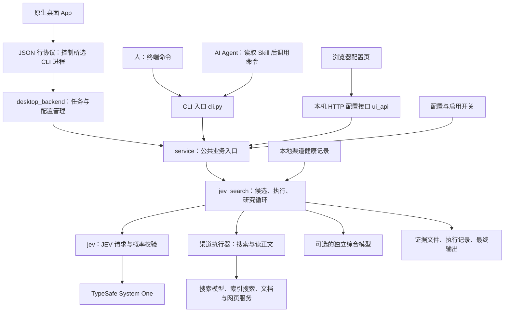
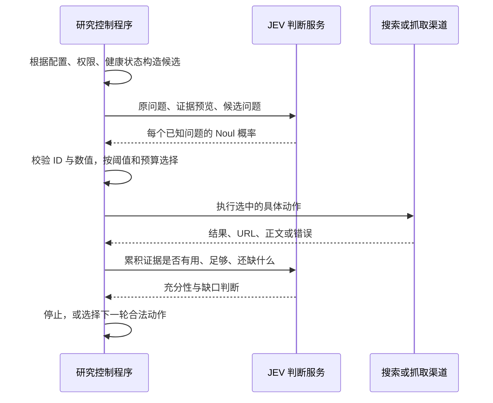
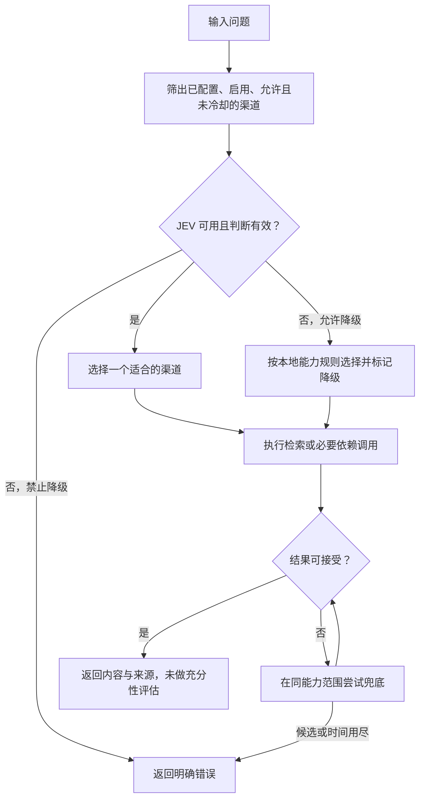
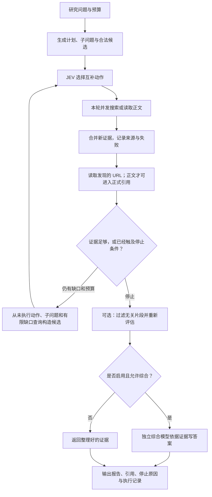
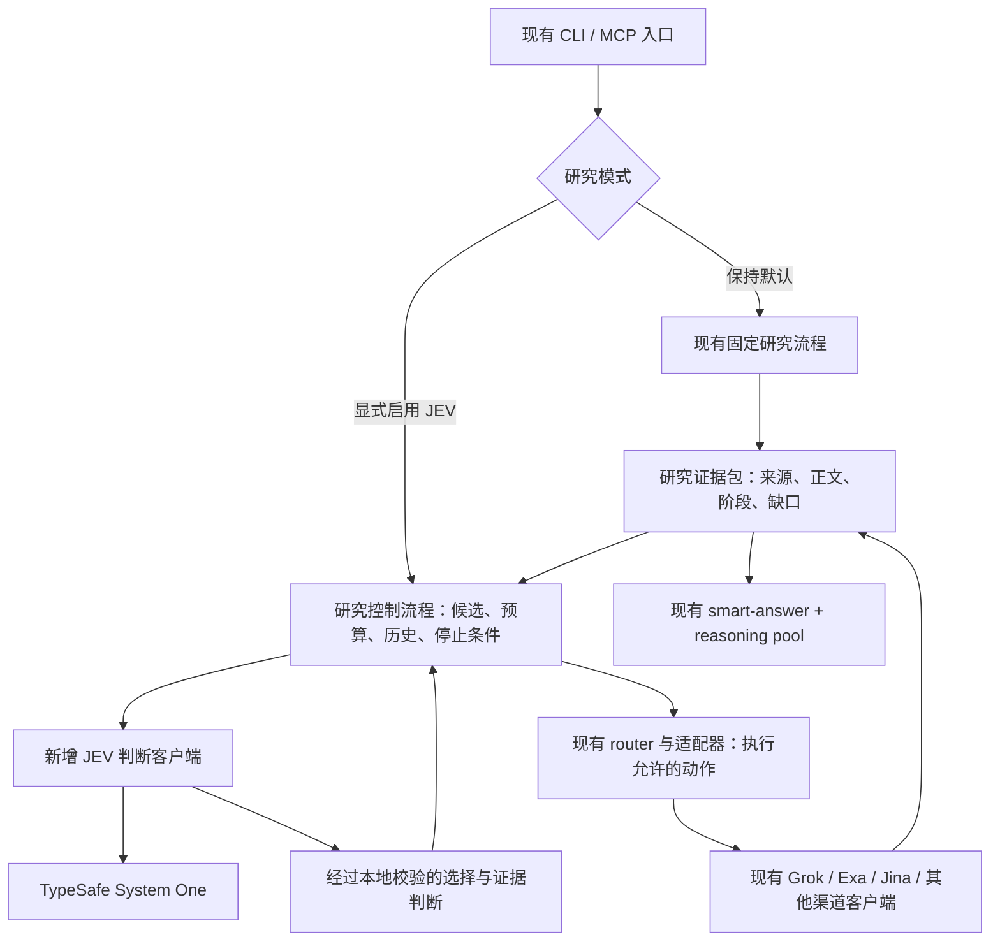

# smartsearch 架构调研与 SourceMux 的 JEV 接入建议

建议让 JEV 帮 SourceMux 判断两件事：下一步用哪个服务查资料，以及已经查到的资料能不能回答问题。搜索、读网页和最后写答案，继续使用 SourceMux 已有的能力。JEV 因此需要单独接入，不能作为一家搜索供应商加入列表，也不能替代写答案的模型。

## 1. 阅读范围与结论

调研日期：2026-11-02。参考项目是 [konbakuyomu/smartsearch](https://github.com/konbakuyomu/smartsearch)，源码固定为提交 `1969e4fa32a74d0d48b2c752afbadf496e71ef6e`；本地 SourceMux 基线为 `dd0c5e7f7ea5daebf4a17216b100dde49c2fcaa7`。本文依据这两个源码快照，不把主分支今后的变化算入结论。

本文没有调用 TypeSafe 的真实 API，也没有测量两套系统的速度、费用或回答准确率。下文的协议、阈值和重试行为是 smartsearch 客户端的实现，不是对服务商最新协议或效果的独立保证。「接入建议」均未实现。

配套阅读：[SourceMux 通俗架构说明](ARCHITECTURE_GUIDE_ZH.md)、[现有维护者架构参考](ARCHITECTURE.md)、[可视化对比页](architecture-comparison.html)。

| 先理解这几个词 | 通俗解释 |
| --- | --- |
| CLI | 在终端输入命令，程序执行后返回结果 |
| MCP | AI 客户端调用工具的一套约定 |
| Provider／渠道 | 实际执行搜索或读取网页的服务 |
| 路由 | 决定这次请求交给哪个渠道 |
| fallback／兜底 | 某条路径不可用时，按规则换一条路径 |
| 证据 | 查到的来源、摘要或读到的正文；这三者可靠程度不同 |
| JEV | TypeSafe 提供的判断服务。程序把问题和已有资料发给它，它用概率表示是否支持某个判断 |
| 综合模型 | 阅读收集好的证据，组织成最终答案的模型 |

## 2. smartsearch 的整体架构

smartsearch 的搜索程序用 Python 编写，通过 CLI 命令运行。人可以直接输入命令，AI 可以按 Skill 中的说明调用命令，桌面 App 也可以控制这个程序。浏览器配置页用来管理设置。这些入口共用 CLI 核心的业务代码，桌面 App 没有另写一套搜索逻辑。

图中的箭头表示「调用谁」或「从谁那里取得数据」。一次请求只经过需要的部分：例如普通 search 不调用最后写答案的模型；桌面 App 与 CLI 通信时，也不经过浏览器配置页的 HTTP 服务。

### 2.1 各部分承担什么责任

| 部分 | 责任 | 不应误解为 |
| --- | --- | --- |
| `cli.py` | 解释命令参数、调业务函数、格式化结果 | 搜索算法本身 |
| `service.py` | 提供统一业务入口、配置与供应商调用、离线研究计划 | 每个功能都有一个独立的小模块；该文件仍承担较多职责 |
| `jev_search.py` | 列出允许的操作，选出后同时执行；需要时继续搜索，再整理结果 | 让模型随意生成并运行命令 |
| `jev.py` | 请求 JEV、检查概率、判断证据、过滤与综合相关决策 | 自己拥有网页搜索索引 |
| `provider_descriptions.py` | 描述每个具体操作擅长什么、不适合什么 | 供应商所有公开能力都已接入 |
| `providers/` | 对接 xAI、OpenAI 兼容服务、Exa、Context7、Jina 等服务 | 所有调用都已从 `service.py` 完全拆出 |
| `provider_health.py` | 把故障记录存到文件，下次运行时暂时跳过仍在等待恢复的渠道 | 不在暂停使用期，只表示允许尝试，并不证明这次一定成功 |
| `sources.py`、研究证据目录 | 保存来源与研究产物，支持追溯 | 搜索成功即等于事实正确 |
| 桌面 App 与配置网页 | 展示状态、修改配置、管理运行任务 | 另一套独立搜索后端 |

当前参考实现主要让人或 AI 通过 CLI/Skill 使用功能。桌面 App 与 CLI 之间约定了自己的消息格式：每行发送一个 JSON 对象，称为 JSON 行协议。它虽然也用标准输入输出传消息，却不是 SourceMux 对外提供的 MCP server。smartsearch 中出现的智谱 MCP，则是它向外调用的服务。

### 2.2 配置、状态与分发

smartsearch 既读取配置文件，也读取运行环境中的变量；同一项设置两边都有时，以环境变量为准。配置保存设置，渠道健康记录保存故障情况，活动元数据记录运行情况，研究正文保存查到的材料。故障记录会写入文件，所以程序退出再启动后，仍能暂时跳过故障渠道。程序还记录凭据的指纹，用来识别连接设置是否变化；更换凭据后，旧故障记录不再沿用。

桌面 App 与 CLI 分别安装和升级。通过 npm 安装 CLI 时，对应操作系统的安装包已经带上打包好的 Python 运行环境。App 连接 CLI 前，会检查双方是否支持同一版本的通信协议。浏览器配置页则按需在本机启动。接入 JEV 不要求同时引入这些安装和管理功能。

证据：[桌面边界说明][s-app]、[桌面协议][s-protocol]、[配置实现][s-config]、[健康状态实现][s-health]。

## 3. JEV 到底做什么

程序先列出本次允许做的事，再交给 JEV 判断。例如「用哪个渠道，搜索什么词」或「用哪个渠道，读取哪个 URL」，各算一个候选动作。程序会给判断问题编号，也就是问题 ID。收到回答后，只读取自己发出的 ID，并检查概率是否合法；响应里多出来的工具指令不会被执行。

例如同一问题有三个合法候选：「用 Exa 找官方介绍」「用 Grok 找近期讨论」「读取已经发现的文档 URL」。JEV 可以给候选评分；具体能否执行、一次选几个、超时多久，仍由程序控制。

这张图按先后顺序展示 research 中的调用。「充分性评估」就是判断现有资料是否足以回答原问题；「补搜」就是资料不足时继续查找。普通 search 不执行这两步。

### 3.1 参考客户端的接口契约

| 项目 | 源码中的行为 |
| --- | --- |
| 地址 | 默认 base 为 `https://api.typesafe.ai/v1`，补上 `/systemone` |
| 认证 | HTTP `Authorization: Bearer …` |
| 请求 | `model`、`state`、`questions` |
| 问题描述 | `type=noul`、判断说明，以及真／假的判定标准 |
| 返回 | `answers[问题ID].type=noul` 与 `answers[问题ID].noul` |
| 校验 | 必须为有限数字且在 0–1；布尔值、缺项、错误类型均拒绝 |
| 超时 | 默认单次判断总预算 15 秒，同时受整个任务剩余时间限制 |
| 重试 | 对 429、529 最多尝试 3 次；退避等待也在判断总预算内 |
| 记录 | 阶段、问题数量、耗时、错误及服务返回的 token 用量 |

Noul 是接口返回的一种概率值，表示模型有多支持某个判断。例如，对「现有资料足够回答问题」返回 0.8，表示模型比较支持这个判断，不能据此认定答案有 80% 的正确率。阈值是程序用来决定是否采纳判断的分界值，也不是可靠性保证。接入前还需要对照官方说明，用测试账号确认请求格式和返回格式。

证据：[JevClient 与配置、概率校验][s-jev]。

## 4. 普通搜索与深入研究是两条流程

### 4.1 普通 search：一次选路，有限兜底

「一次选路」指只决定一次主要检索方向，实际仍可能请求服务几次。例如 Context7 需要先找到对应的库，再读取文档；搜索模型给出的答案也可能交给 JEV 做 `answer_check` 检查。如果渠道出错或答案未通过检查，程序可以换一个提供同类能力的渠道重试，但不会因此开始反复补搜。

普通 search 禁用结果过滤、充分性评估和最终综合。`extra-sources` 控制所选渠道返回多少结果，不表示额外调用多少个渠道；上限为 20。`evidence_assessment.status=not_evaluated` 明确表示尚未做充分性评估。

### 4.2 research：搜索、读正文、看缺口、再决定

程序负责准备可选的搜索词，包括原问题、计划中拆出的子问题，以及针对缺失信息套用模板得到的查询。「缺口」就是当前资料还没有回答的部分。JEV 只从这些候选中选择，不自行编写任意查询或工具调用。渠道、操作、查询和 URL 全部相同的动作不会重复执行。只有已经知道 URL，程序才会提供读取网页的选项；每轮最多考虑 5 个已知 URL。

研究不一定要用完所有轮数。资料已经够用时可以提前停止；次数用完、时间到期、没有新动作可做或查不到新资料时，也会结束。这里的「预算」指允许的轮数、操作数、结果数和时间。无法判断资料是否足够时，程序保留已有结果并标记未核验，不会仅凭接口请求成功就报告研究成功。

| 研究预算 | 轮数上限 | 每轮操作数上限 | 每渠道结果数上限 | 时间上限 |
| --- | --- | --- | --- | --- |
| quick | 2 | 1 | 3 | 45 秒 |
| standard | 3 | 2 | 5 | 120 秒 |
| deep | 10 | 10 | 20 | 配置的任务总时限 |

实际值还要与用户 JEV 配置取较小值。JEV 默认配置为 3 轮、每轮 3 操作、每渠道 5 结果，因此 deep 默认不等于 10 轮并发 10 个渠道。任务默认总时限为 300 秒；research 的 deep 使用 strict，quick/standard 使用 balanced。

quick、standard 的时间也与配置总时限取较小值。`research` 默认使用 deep 预算。默认选路阈值为 0.5，充分性阈值为 0.75；这些是参考策略，不能直接当作本项目适用的参数。

`deep` 命令本身是离线计划器，不执行这张循环图。在线执行入口是 `research`。证据：[业务入口][s-service]、[循环及研究结果实现][s-search]、[路由说明][s-routing]。

### 4.3 证据、过滤和综合的边界

搜索结果里的摘要和模型回答主要用来发现值得继续阅读的页面。research 的正式引用列表 `citations` 只收录实际 fetched/read（已抓取或读取）过的正文。Context7 读取到的文档可以进入引用列表，仅介绍某个库的文字不算文档正文。

判断资料是否足够时，JEV 看到的是预览，未必是全文。预览转换成传输文本后，最多约 20,000 字符；程序可能只选取相关段落，并标记哪些内容被省略。因此，这项判断只基于发给 JEV 的部分，不能证明它检查过整页。

结果过滤默认关闭。开启后，程序先把正文分成段落，再把段落分组，请 JEV 判断每组里是否至少有一段有用。需要细查的组会继续拆分。按默认规则，相关概率低于 0.1 才删除。判断失败、超时或删除后没有材料留下时，程序恢复原文；只删掉部分内容时，则重新判断剩余资料是否够用。

最后综合独立配置，默认关闭。`true` 直接尝试综合；`auto` 请 JEV 判断是否值得综合；`false` 返回证据。综合请求不附带搜索工具；失败保留证据与警告。它不复用搜索模型的 Key、地址或模型覆盖参数。

### 4.4 判断不可用时如何结束

默认 jev 模式缺 Key 时，允许 fallback 就使用本地能力规则，并标记降级；禁止 fallback 则在检索前失败。显式 local 模式不调用 JEV。研究无法获得充分性判断时，可读取首批发现的正文，然后以 `judgment_unavailable` 停止；balanced 可以返回未验证的部分结果，deep/strict 不能将其报告为充分成功。

`fallback=off` 还会限制后续补搜，但 research 仍可读取首次发现的 URL。选路失败或所有候选都未达阈值时，不能把最高分候选冒充为有效选择。输出中的 `fallback_used` 也可能因正常多轮执行而置为 true，不能单凭这个字段认定发生供应商故障。

## 5. 与当前 SourceMux 的差异

| 比较维度 | 当前 SourceMux | smartsearch 参考快照 | 对接入的意义 |
| --- | --- | --- | --- |
| 产品入口 | Go 单二进制 CLI + stdio MCP | Python CLI + Skill + 原生 App + 配置网页 | 保留现有 CLI/MCP，无需引入 App |
| 配置 | 默认当前目录一个 JSON，或显式 `--config` | 用户配置 + 环境变量覆盖 | 不照搬环境变量链 |
| search 选路 | 默认 Grok→TinyFish→Exa→Tavily，按执行结果兜底 | JEV 从可用渠道选一个，失败时同能力兜底 | 先判断适合用哪家，再交给现有路由去执行 |
| docs-search | 当前仅 Exa 文档搜索适配器 | 包含 Context7 的库定位与文档读取能力 | JEV 本身不能补出未接入的渠道 |
| fetch | profile、URL 意图、显式配置共同决定顺序 | research 可把读网页列为候选动作；独立 fetch 仍有固定兜底 | 复用现有抓取，新增行动选择 |
| research | 固定模板查询，有限并发，排序、抓取、规则摘句 | 每轮读完资料后，判断还缺什么，再决定继续搜什么、读什么 | 核心差距在执行流程控制 |
| 最终答案 | `smart-answer` 使用独立 reasoning pool | research 可选独立综合模型 | 已有分工可复用 |
| 证据可信度 | `confirmed_facts` 为启发式摘句，存在质量过滤 | JEV 判断有用性、充分性和缺口 | 概率判断也不等于事实核验 |
| 错误与追踪 | 统一 outcome、路由 trace；永久错误会终止该路由 | 逐轮决策、调用记录、缺口和停止原因 | 区分执行失败与判断不可用 |
| 故障状态 | Grok pool 会暂时跳过故障入口；CLI 退出后不保留这份记录 | 将可选渠道的故障记录写入本地文件，下次运行仍可使用 | 跨调用冷却属于独立增强项 |
| 研究文件 | 可输出 plan/search/fetch/summary 产物 | 计划、正文、summary、report，并区分 discovery/citations | 优先统一证据阶段与来源记录 |
| 研究预算 | quick/standard/deep 限制查询和抓取规模 | 同时限制轮数、操作数、结果数、总时限 | 动态循环必须有统一总预算 |

SourceMux 的 `router` 负责按规定顺序调用服务，并根据成功或失败决定是否换下一家。JEV 则帮助决定当前该搜什么、读什么，以及已有资料是否够用。SourceMux 已能根据 URL 类型和 profile 规则选择服务，但还不会像 JEV 研究流程那样，读完资料后判断缺什么，再决定下一步。

## 6. 建议的接入架构：保留执行层，增加判断与循环

本节是调研建议，不是已批准实施计划。建议以 research 的可选模式开始，验证收益后再考虑改变普通 search 的选路。

### 6.1 三种方案与推荐

| 方案 | 具体做法 | 收益与代价 |
| --- | --- | --- |
| A：只加证据评估 | 固定研究完成后，让 JEV 标记是否足够、缺什么 | 改动最小，可先验证判断质量；不会自动补搜 |
| B：增加受限研究循环，推荐目标 | 保留默认流程；JEV 模式选择动作、读正文、检查缺口、有限补搜 | 对应主要需求；需要记录允许的动作、剩余时间和次数，并明确失败时返回什么 |
| C：全面改成 smartsearch 式平台 | 同时迁移配置、健康存储、桌面管理和渠道目录 | 范围显著扩大；这些能力不是 JEV 接入所必需 |

建议先用 A 验证判断是否可靠，再实现 B。不要第一步就改默认搜索顺序或复制整个 Python 编排模块。

### 6.2 可能涉及的改动范围

| 位置 | 拟变更 | 规模与影响 |
| --- | --- | --- |
| `internal/config` | 增加可选 JEV 连接与研究模式设置 | 中；保持单文件配置，明确 v1/v2 映射 |
| `internal/engine` | 新增 JEV HTTP 客户端、协议与数值校验 | 小到中；独立于搜索和 reasoning 客户端 |
| `internal/tools/research.go` 及相邻文件 | 管理候选、证据评估、循环预算、停止原因 | 中到大；主要行为变化在这里 |
| `internal/capability`、`internal/router` | 核实请求字段足以执行候选；只补必要字段 | 待设计确认；不把概率判断塞进网络错误分类 |
| `internal/cli`、`internal/server` | 两个入口使用同一研究配置与返回语义 | 中；防止 CLI 能用而 MCP 不支持 |
| 测试、示例配置、CLI/MCP 文档 | 增加假服务响应、回归案例与可见行为说明 | 中；不访问真实外部 API |

JEV 应有单独的连接设置。`grokEndpoints[]` 用于联网搜索，`reasoningEndpoints[]` 用于写答案，而 JEV 的 `/systemone` 请求和响应格式与两者不同。具体配置字段留到实施设计时确定，本文不引入尚未验证的新格式。

### 6.3 实施时必须保持的约束

1. 只把已配置、启用、允许的渠道放入候选。拿到结果后再次确认候选 ID，不执行模型凭空返回的动作。
2. 查询与 URL 来自原问题、有限子问题、缺口模板和已发现来源。固定组合只执行一次。
3. 任务只有一个总截止时间；JEV 判断、重试、搜索、抓取与综合都消耗剩余预算。轮数之外还要限制总调用数，防止一轮内大量读网页。
4. JEV 不可用时明确标记 `unknown` 或降级，不伪造概率。继续保留已有证据；是否回到固定研究流程应有可测试的约定。
5. 区分「发现链接」「读到正文」「判断充分」「最终答案」。搜索摘要不能悄悄升级为已读正文。
6. 来源内容是待分析数据。不能允许网页里的指令改变候选白名单、预算或配置。
7. 请求 JEV 会把问题和证据片段发送给另一个服务。配置说明必须讲清这一数据流；不发送供应商凭据，不在 trace 中记录 Key。

### 6.4 验收方式建议

先做本地假服务测试：正确概率、缺少问题 ID、未知 ID、布尔值、越界值、429/529、超时与预算取消。再做执行流程测试：候选被禁用、正文为空、判断不可用、证据充分提前结束、无新证据结束、严格引用约束、某渠道失败时保留其他结果。

使用同一批问题比较固定模式与 JEV 模式，记录实际正文来源、缺口是否解决、调用次数、耗时与成本。费用需要真实用量与服务定价，本文不作估算。仅在这些检查证明收益后，再讨论是否默认开启。

## 7. 证据索引与调研限制

参考源码固定链接如下，避免主分支更新后无法复核：

| 结论 | 源码位置 |
| --- | --- |
| JEV 配置、概率与 HTTP 协议 | [jev.py，第 20–218 行][s-jev] |
| 渠道目录、候选查询与执行器 | [jev_search.py，第 27–313 行][s-search] |
| search/research 的分流、循环与研究产物 | [jev_search.py，第 351 行起][s-search]；[service.py，第 1491、2227 行起][s-service] |
| deep 离线计划 | [service.py，build_deep_research_plan，第 1224 行起][s-service] |
| 路由模式兼容映射 | [intent_router.py，第 7–14 行][s-intent] |
| 跨进程故障冷却 | [provider_health.py][s-health] |
| 桌面／CLI 与打包职责 | [app-cli-boundary.md][s-app]；[desktop/PROTOCOL.md][s-protocol] |
| 配置网页与本地接口安全边界 | [ui_server.py][s-ui] |
| JEV 行为测试 | [tests/test_jev.py][s-tests]；[tests/test_search_modes.py][s-modes] |
| 本地现状的源码索引 | [SourceMux 通俗架构说明](ARCHITECTURE_GUIDE_ZH.md) |

工具与技能：读取本地源码；经授权以 Git 下载公开参考源码；使用 SourceMux routing 技能尝试 URL 抓取，但该次请求因沙箱 DNS 失败，未作为内容证据；使用 FEX 中文写作规则和 answer-me-with-html 生成配套说明。MindOS 历史读取因本机缺少 `jsonc-parser` 失败，未使用历史知识库结论。

未运行 smartsearch 的完整测试套件，未验证真实 JEV 响应、服务可用性、概率校准、性能和成本。本次仅新增文档与展示产物，不改变运行时行为。

[s-jev]: https://github.com/konbakuyomu/smartsearch/blob/1969e4fa32a74d0d48b2c752afbadf496e71ef6e/src/smart_search/jev.py#L20
[s-search]: https://github.com/konbakuyomu/smartsearch/blob/1969e4fa32a74d0d48b2c752afbadf496e71ef6e/src/smart_search/jev_search.py#L27
[s-service]: https://github.com/konbakuyomu/smartsearch/blob/1969e4fa32a74d0d48b2c752afbadf496e71ef6e/src/smart_search/service.py#L1491
[s-intent]: https://github.com/konbakuyomu/smartsearch/blob/1969e4fa32a74d0d48b2c752afbadf496e71ef6e/src/smart_search/intent_router.py#L7
[s-routing]: https://github.com/konbakuyomu/smartsearch/blob/1969e4fa32a74d0d48b2c752afbadf496e71ef6e/docs/jev-routing.md
[s-config]: https://github.com/konbakuyomu/smartsearch/blob/1969e4fa32a74d0d48b2c752afbadf496e71ef6e/src/smart_search/config.py#L310
[s-health]: https://github.com/konbakuyomu/smartsearch/blob/1969e4fa32a74d0d48b2c752afbadf496e71ef6e/src/smart_search/provider_health.py
[s-app]: https://github.com/konbakuyomu/smartsearch/blob/1969e4fa32a74d0d48b2c752afbadf496e71ef6e/docs/app-cli-boundary.md
[s-protocol]: https://github.com/konbakuyomu/smartsearch/blob/1969e4fa32a74d0d48b2c752afbadf496e71ef6e/desktop/PROTOCOL.md
[s-ui]: https://github.com/konbakuyomu/smartsearch/blob/1969e4fa32a74d0d48b2c752afbadf496e71ef6e/src/smart_search/ui_server.py
[s-tests]: https://github.com/konbakuyomu/smartsearch/blob/1969e4fa32a74d0d48b2c752afbadf496e71ef6e/tests/test_jev.py
[s-modes]: https://github.com/konbakuyomu/smartsearch/blob/1969e4fa32a74d0d48b2c752afbadf496e71ef6e/tests/test_search_modes.py
